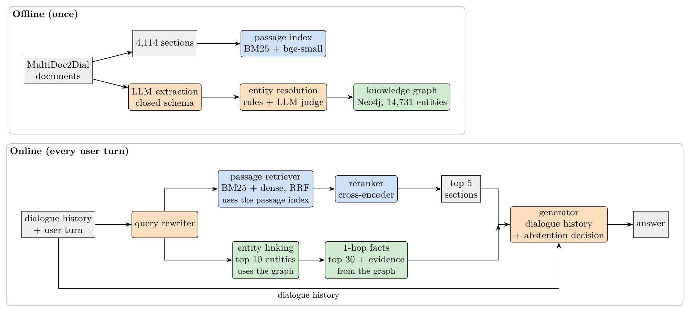

# Conversational RAG and Knowledge Graphs

A conversational question-answering system over the [MultiDoc2Dial](https://doc2dial.github.io/multidoc2dial/) documents (US government services: DMV, SSA, VA, StudentAid). It answers each user turn from retrieved passages and from facts of a knowledge graph built from the same documents, and abstains when the documents do not contain the answer. Research project in the [Master Degree in Computer Engineering](https://degrees.dei.unipd.it/master-degrees/computer-engineering/), [University of Padua](https://www.unipd.it/en/); supervisor Prof. Gianmaria Silvello.

Author: Danil Smirnov - danil.smirnov@studenti.unipd.it

## Key findings

* **The graph alone is worse than passages.** Graph sections reach 23.0 and graph facts 24.1 token F1 on validation, against 26.9 for passage retrieval (test: 23.8 vs 26.9 for graph facts).
* **Graph facts added to the passages give a small gain on answerable questions** (validation 27.7 vs 27.2, test 28.0 vs 27.1), which the same number of random facts does not give (27.2 and 27.1).
* **Giving the generator the dialogue history, with the abstention decision taken separately, gives the best result**: passages + graph facts reach 28.2 overall and 28.4 on answerable questions on test, +0.6 and +0.9 over passages. Filtering, reordering or reranking with the graph did not do better.
* **A model that checks its own context does not help.** It can tell when the retrieved context lacks the gold section (Youden's J 0.33), but one more search or a tool-calling agent does not recover the section often enough to beat the system above, and an agent that refuses on its own almost never refuses.
* **An LLM judge agrees on test**: passages + graph facts score 68.5 against 67.3 for passages (+1.3 [0.3, 2.2]); on validation it shows no difference.
* **The graph invents few facts but has noisy entities**: relation precision 78.3%, entity precision 58.0%, mostly from names, merges and relation types.

## Architecture



| Component | Module |
| :--- | :--- |
| Sections, dataset loading | `src/data/` |
| Passage index, retriever (BM25 + bge-small, RRF), reranker (bge-reranker-base) | `src/rag/` |
| Query rewriter | `src/rag/query_rewriter.py` |
| LLM extraction, entity resolution, Neo4j loading | `src/kg/` |
| Entity linking, 1-hop fact retrieval | `src/kg_rag/` |
| Sufficiency check, context extension, tool-calling agent (experiments) | `src/agents/`, `experiments/agent.py` |
| LLM client, cache, per-call token usage log | `src/llm/` |
| Generator prompt, dialogue history, abstention decision | `experiments/run_dev_subset.py`, `experiments/generator_input.py` |
| Metrics | `src/evaluation/` |

## Configurations evaluated

All use the same generator and prompt; they differ in what the context contains.

* **LLM only**: no context.
* **Passages**: the top 5 sections from the rewriter, retriever and reranker.
* **Graph sections**: the sections reached through the linked entities.
* **Graph facts**: up to 30 facts of the linked entities, each with an evidence quote.
* **Passages + graph facts**: the top 5 sections plus the graph facts in a separate block.
* **Passages + random facts** (control): the same number of random facts from the same domain.
* **Oracle**: the gold sections of the question.
* **Passages + top 10 graph facts**: only the 10 facts with the best cross-encoder score against the query.
* **..., with dialogue history**: the generator also sees the whole dialogue so far; whether to abstain is decided by the prompt without history.

## Results

Token F1 (%), all questions / answerable questions only. Validation: 4,427 questions; test: 4,335, run once with the frozen systems.

| Configuration | Validation | Test |
| :--- | :---: | :---: |
| LLM only | 15.8 / 15.7 | 15.1 / 15.0 |
| Passages | 26.9 / 27.2 | 26.9 / 27.1 |
| Graph sections | 23.0 / 22.4 | not run |
| Graph facts | 24.1 / 23.8 | 23.8 / 23.3 |
| Passages + graph facts | 27.4 / 27.7 | 27.5 / 28.0 |
| Passages + random facts | 27.4 / 27.2 | 27.3 / 27.1 |
| Passages, with dialogue history | 27.5 / 27.6 | 27.6 / 27.5 |
| Passages + graph facts, with dialogue history | **28.0 / 28.2** | **28.2 / 28.4** |
| Passages + top 10 graph facts, with dialogue history | **28.0 / 28.3** | 27.8 / 28.1 |
| Oracle (upper bound) | 35.5 / 36.5 | 34.2 / 35.1 |

### Generator models

The best configuration (passages + graph facts, with dialogue history) with three generator models on validation; only the generator changes. All three were run fresh, so gpt-5.4-nano differs by 0.1–0.2 from the table above. Token usage is recorded per call; cost at USD list prices (Azure Retail Prices API, Global Standard, East US 2, 21 Oct 2026).

In the experiments every LLM call of the system (rewriting, extraction, entity resolution, generation) went to one Azure OpenAI deployment of gpt-5.4-nano, and the judge used gpt-6-luna. The model is not fixed: `src/llm/client.py` talks to any OpenAI-compatible Responses API, and the endpoint and model are set in `.env` (`AZURE_OPENAI_BASE_URL`, `LLM_MODEL`).

| Generator | F1 all / answerable | False abstention | Tokens per turn, in / out (reasoning) | USD per 1,000 conversations |
| :--- | :---: | :---: | :---: | :---: |
| gpt-5.4-nano (used) | **28.1 / 28.4** | 3.9% | 5,793 / 106 (0) | 7.30 |
| gpt-5-nano | 28.1 / 26.8 | 11.6% | 5,532 / 1,578 (1,435) | 5.94 |
| gpt-6-luna | 27.3 / 26.6 | 14.2% | 5,511 / 176 (102) | 3.89 |

The newer models answer as well when they answer (same F1 on the questions all three answer) but refuse more answerable questions.

### Extraction precision

Entities and relations of the full graph were checked separately on 6 documents not used in any earlier annotation (seed 42, stratified by domain; documents sharing a page title or a section with an earlier one excluded). Each row was labelled correct or not with an error type, following fixed rules ([guidelines](experiments/kg_eval/guidelines.md)); intervals are Wilson 95%. Entities are a seeded sample of 150 of the 159 in the 6 documents; all 115 relations were labelled.

| Entity type | Correct | Precision [95% CI] |
| :--- | :---: | :---: |
| **All entities** | **87 / 150** | **58.0 [50.0, 65.6]** |
| Service | 32 / 58 | 55.2 [42.5, 67.3] |
| Requirement | 24 / 47 | 51.1 [37.2, 64.7] |
| Document | 5 / 10 | 50.0 [23.7, 76.3] |
| Role | 8 / 10 | 80.0 [49.0, 94.3] |
| ContactPoint | 7 / 8 | 87.5 [52.9, 97.8] |
| TimeLimit | 5 / 6 | 83.3 [43.6, 97.0] |
| Organization | 2 / 4 | 50.0 [15.0, 85.0] |
| Outcome | 1 / 4 | 25.0 [4.6, 69.9] |
| Amount | 3 / 3 | 100.0 [43.8, 100.0] |

| Relation | Correct | Precision [95% CI] |
| :--- | :---: | :---: |
| **All relations** | **90 / 115** | **78.3 [69.9, 84.8]** |
| REQUIRES | 46 / 57 | 80.7 [68.7, 88.9] |
| APPLIES_TO | 16 / 19 | 84.2 [62.4, 94.5] |
| LEADS_TO | 4 / 8 | 50.0 [21.5, 78.5] |
| AVAILABLE_AT | 7 / 7 | 100.0 [64.6, 100.0] |
| PART_OF | 3 / 6 | 50.0 [18.8, 81.2] |
| HAS_TIME_LIMIT | 6 / 6 | 100.0 [61.0, 100.0] |
| EXEMPT_FROM | 1 / 4 | 25.0 [4.6, 69.9] |
| PROVIDED_BY | 3 / 3 | 100.0 [43.8, 100.0] |
| ALTERNATIVE_TO | 2 / 3 | 66.7 [20.8, 93.9] |
| HAS_AMOUNT | 2 / 2 | 100.0 [34.2, 100.0] |

Errors: entities 27 bad name, 15 wrong merge, 12 wrong type, 9 not an entity; relations 11 wrong relation type, 8 not supported, 4 wrong direction, 2 self or circular, 0 negation lost. The graph invents few facts (7% of relations unsupported, 6% of entities not real); the main problems are names, merges and the relation type.

### Graph RAG variants

Attempts to keep the graph's help on retrieval misses while removing off-topic facts, all with dialogue history, chosen on validation and run once on test:

* **Top 10 facts by cross-encoder score** match all 30 facts on validation with 35% fewer generator input tokens, and are 0.4 points below them on test (still +0.6 over passages on answerable questions).
* **Facts from outside the top 5 passages first** recover the questions where retrieval misses but a fact points to the right section, without a gain overall.
* **The graph as a reranker signal** (cross-encoder score + graph score) lowers Recall@5 for every weight above 0, so it was not used for generation.
* **Two-hop paths** between linked entities reach no gold section that one-hop facts miss, so they were dropped.

### Agents

Can the model judge that the retrieved context is not enough, and does looking further help? Both variants start from the final system (passages + 30 facts, dialogue history, citations) and were run on dev-500 (500 questions) with the stopping rule fixed in advance: keep a variant only if the interval of its F1 difference to the final system on all questions is above 0, or it ties at 10% lower cost.

| System | Δ F1 all | Δ F1 answerable | USD per 1,000 turns |
| :--- | :---: | :---: | :---: |
| Final system | – | – | 1.39 |
| Check + one extra round, abstention from G0 | −0.6 [−1.6, 0.4] | +0.1 [−0.5, 0.6] | 2.29 (+65%) |
| Tool-calling agent, abstention from G0 | −1.5 [−2.9, −0.1] | −0.9 [−2.0, 0.1] | 1.98 (+42%) |
| Tool-calling agent, its own refusal | −2.8 [−4.5, −1.3] | −0.5 [−1.6, 0.6] | 1.23 (−12%) |

* **The check works**: Youden's J 0.33 [0.23, 0.42] against "the gold section is in the context", and it calls 58% of the unanswerable questions insufficient.
* **The extra round adds little**: the new query alone finds a gold section less often than the original query (45.5% against 53.5%), the union adds 5.6 points of recall, and the larger context makes G0 abstain less.
* **The agent used a tool on 44% of the questions.** With its own refusal it ties the final system on answerable questions at 12% lower cost, but it refuses almost never (abstain recall 3% against 42%).
* Neither variant qualified, so neither was run on the full validation or the test split. An exploratory check (not planned) found that ranks 6–10 of the original list hold a gold section more often than the new query (8.9% against 5.6% of the answerable questions sent to the round), which is left as future work.

### LLM judge

Token F1 only counts word overlap with the reference, so correct paraphrases score low. A second model, gpt-6-luna, rates each answer of the final systems as correct, partial or incorrect against the reference answer and the gold section, and says separately whether the answer is supported by the documents. Abstentions are scored by rule (correct only on unanswerable turns), citations are stripped, and the score is 1 / 0.5 / 0. The judge was checked against 60 hand-labelled answers of the three systems (half at random, half where judge and F1 disagree most): Cohen's kappa 0.65 for the three classes, 90% agreement on correct+partial vs incorrect. The results are reported next to F1 only; no system was re-selected on them.

| System | Validation judge / F1 | Test judge / F1 |
| :--- | :---: | :---: |
| Passages, with dialogue history | 66.3 / 27.5 | 67.3 / 27.6 |
| Passages + graph facts, with dialogue history | 66.7 / 28.0 | **68.5 / 28.2** |
| Passages + top 10 graph facts, with dialogue history | 66.9 / 28.0 | 67.3 / 27.8 |

| Paired difference [95% CI] | Validation judge | Validation F1 | Test judge | Test F1 |
| :--- | :---: | :---: | :---: | :---: |
| + graph facts vs passages | +0.4 [−0.4, 1.3] | +0.5 [0.1, 0.9] | +1.3 [0.3, 2.2] | +0.6 [0.2, 1.0] |
| top 10 facts vs all facts | +0.2 [−0.6, 1.0] | −0.0 [−0.4, 0.4] | −1.2 [−2.0, −0.4] | −0.4 [−0.7, 0.0] |

On test the judge agrees with F1 and separates the systems more clearly: passages + graph facts are best, and keeping only the top 10 facts costs quality. On validation the judge shows no difference between the three.

Caveats:

* The judge and the generator are from the same model family (OpenAI).
* The judge is stricter than the human labels: in 9 of the 12 disagreements its verdict is lower.
* One test question is left out for all three systems because the Azure content filter blocked the judge prompt (4,334 of 4,335 questions; the F1 differences above are on the same questions).
* On dev-500 the judge also scored the agents; their extended contexts are not stored, so for them "supported" is checked against the gold section only.

## Example

A follow-up turn of a validation dialogue (DMV, traffic tickets), answered by passages + graph facts:

| | |
| :--- | :--- |
| User | what if im a holder of a junior license? |
| Reference | you can not plead by mail or online. you still must appear for a hearing in a tvb office. |
| Answer | If you are a holder of a probationary/junior license or a learner permit, you cannot plead by mail or online. You must appear for a hearing in a TVB office. (F1 0.67; passages alone: 0.51) |
| Graph fact | `probationary / junior license or learner permit (Role) exempt from plead by mail or online (Service)`, evidence: "you cannot plead by mail or online" (Traffic Violations Bureau, APPEALS) |

The relation name is not right (these drivers cannot plead by mail), but the evidence quote is, which is why every fact is given to the model with its quote.

## Quick start

```bash
python3 -m venv .venv && source .venv/bin/activate
pip install -r requirements.txt
cp .env.example .env        # fill in the values; each variable is explained in .env.example
```

Put MultiDoc2Dial v1.0 into `data/multidoc2dial/`. The graph configurations also need the knowledge graph, see [docs/graph_build.md](docs/graph_build.md). LLM answers are cached in `experiments/cache/`, so with an existing cache the commands below make no new calls. To reproduce the validation column of the results table:

```bash
python experiments/run_split.py --split validation --workers 12                      # LLM only, oracle, passages
python -m src.kg_rag.run_qa --split validation --workers 12                          # graph configurations
python -m src.kg_rag.eval_qa --split validation                                     # F1 of passages and graph configurations
python experiments/generator_input.py --split validation --k all                     # with dialogue history
```

LLM only and the oracle are scored with `python experiments/evaluate_diagnostics.py --inputs experiments/results/validation/*.jsonl`. The test column uses `run_split.py`, `run_qa` and `eval_qa` with `--split test`.

## Demo

A local chat over the final system (`demo/`), built on the experiment code: its prompts are identical to the evaluated systems (`python demo/check_replay.py`, 194 of 194). You can switch between the three final systems and see the sources, retrieved passages, graph facts and cost of each turn. Neo4j is not needed; the graph is read from its JSON exports.

```bash
pip install -r demo/requirements.txt
python demo/app.py                                  # http://127.0.0.1:7860
python demo/app.py --share --auth user:password     # temporary public link, --auth required
```

A turn takes about 7–11 s and costs USD 0.0006–0.002. Unlike the evaluation, the history holds the system's own answers instead of the gold agent turns.

## Repository map

* `src/`: the system (`data`, `llm`, `rag`, `kg`, `kg_rag`, `evaluation`) and the agent experiments (`agents`).
* `experiments/`: run and evaluation scripts, result summaries (`results/`), the reports of the graph work (`kg/`, `kg_rag/`) and the extraction precision labels (`kg_eval/`).
* `demo/`: the local demo chat.
* `docs/`: the experiment log, the graph build guide and the figures.
* `latex_report/`: the full report (unipd-thesis-modern template).
* `slides/`: the presentation (Beamer).
* `tests/`: unit and regression tests (`python -m pytest tests`).
* `data/`: the dataset (not tracked), the development subset ids and the index cache.

Raw outputs (`*.jsonl`) and LLM caches are not tracked.

## Reports and documentation

* [Full report](latex_report/main.pdf), source in [latex_report/](latex_report/).
* [Slides](slides/main.pdf), source in [slides/](slides/).
* [Experiment log](docs/experiment_log.md): the history of the experiments, with the old step names.
* [Graph build](docs/graph_build.md): Neo4j setup and the commands to build the knowledge graph.

## Status and future work

The system on MultiDoc2Dial is finished: the final configuration (passages + graph facts, with dialogue history) was chosen on validation and run once on test, and the agents, the LLM judge and the extraction precision check are done. No result above will change.

Future work:

* **EnronQA and MTRAG.** Run the same pipeline on two more datasets, agreed with the supervisor: EnronQA (questions over a company's email collection) and MTRAG (multi-turn conversations over several document collections). The aim is to see whether the findings hold outside the government-service documents of MultiDoc2Dial: the graph's small gain over passages, the value of the dialogue history with a separate abstention decision, and the low use of a self-checking agent.
* **A second retrieval round from ranks 6–10** of the original list with a separate refusal decision. The idea comes from an exploratory check after the agent experiments, so it needs a fresh validation run.
